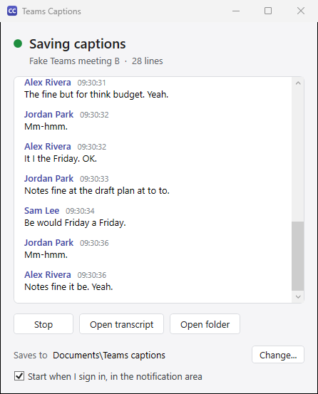

# Teams Captions

Saves the live captions from Microsoft Teams meetings to Markdown files you can read later.

It reads the captions Teams shows on screen through Windows UI Automation. It needs no admin rights, no Teams setting and no meeting transcription, and it records no audio.

Teams Captions is an independent tool, not made by or affiliated with Microsoft.



## Legal notice: you're responsible for how you use it

Teams Captions saves the text of what people say in Teams meetings. Saving a conversation may count as recording it, and recording laws vary: in some places, including several US states such as California and Washington, everyone in the conversation must consent first; in others, such as under the EU's GDPR, a transcript is personal data with its own rules. Workplaces often have their own policies too.

Teams Captions does not notify anyone in the meeting. It is solely your responsibility, as the user, to:

- find out which laws and policies apply to you and to everyone in the meeting;
- tell the other participants and get their consent wherever the law or your organization requires it;
- store, share and delete transcripts lawfully.

Don't use Teams Captions where you don't have the right to keep a record of the conversation. The author provides it as is, without warranty, and accepts no liability for how it is used (see the [licence](LICENSE)). Nothing here is legal advice; if you're unsure, ask a lawyer.

The app shows this notice the first time it runs and saves nothing until you accept it.

## Install

You need Windows 10 or 11 and the new Teams app (`ms-teams.exe`). No admin rights are needed.

### Download the app

1. Get `TeamsCaptions.exe` from the [latest release](https://github.com/d-pender/teams-captions/releases/latest).
2. Move it to a folder you'll keep, not Downloads; for example `Documents\Teams Captions`.
3. Double-click it. The exe isn't code-signed, so Windows may say it protected your PC: choose **More info**, then **Run anyway**. The first time, it shows the legal notice above; choose **I understand** to go on.
4. In the app, tick **Start when I sign in** to have it running in every meeting. For a desktop icon, right-click the exe and choose Show more options > Send to > Desktop (create shortcut).

To update, exit Teams Captions from its notification-area icon, replace the exe and start it again. To remove it, untick **Start when I sign in**, exit it and delete the exe.

### Or build it yourself

The app is built with the C# compiler that comes with Windows, so nothing else needs installing. Download the repository, as a ZIP from GitHub or with `git clone`, then run this in its folder:

```bash
powershell -NoProfile -ExecutionPolicy Bypass -File Build-App.ps1 -Install -StartAtSignIn -Launch
```

This builds the app and installs it in `%LOCALAPPDATA%\Programs\Teams Captions` with a **Teams Captions** shortcut on the desktop. With `-StartAtSignIn` it starts in the notification area whenever you sign in. `-Launch` starts it now. Leave out either switch if you don't want that.

Run the same command again to update; it closes the running copy first, which saves its transcript.

To remove the app, run `Build-App.ps1 -Uninstall`. It closes the app and removes it, its shortcuts and its settings. Your transcripts stay where they are.

## Use

1. Turn on live captions in a Teams meeting (More > Language and speech). They can stay in the meeting window or be popped out, pinned or not.
2. Saving starts by itself. The window shows the captions as they're saved; click the CC icon in the notification area to open it.
3. Close the window when you like: the app keeps saving from the notification area. To stop it completely, right-click the CC icon and choose Exit.

Transcripts go to `Documents\Teams captions\<yyyy-MM-dd HHmm> <meeting>.md`, one file per meeting. Each file is rewritten every 5 seconds while captions arrive, so little is lost if the PC restarts. Three minutes after the captions go away (meeting over, captions off), the transcript is closed and the app waits for the next meeting. If the captions come back sooner, in the same window or another one (a pop-out, say), the same file carries on.

## The window

- **Status:** waiting for captions, saving (with the meeting and line count), captions paused, or not saving.
- **The captions saved so far,** one paragraph per speaker turn, as in the file.
- **Stop / Start** pauses saving. Stopping closes the current transcript. Starting again begins a new one with whatever Teams still shows.
- **Open transcript** opens the file being written, or the last one. **Open folder** opens the transcripts folder.
- **Change...** picks another folder for new transcripts.
- **Start when I sign in** adds or removes the Startup shortcut.

Notifications appear when a meeting's captions start being saved (if the window is closed) and when a transcript is saved; click that one to open the file.

Only one copy runs at a time. Starting it again brings up the window that's already running.

## The transcript

```markdown
# Project sync

Teams live captions, Wednesday 2026-11-11, 15:30 to 15:52.

Speakers: Alex Rivera, Sam Lee.

Captions are machine-generated, so expect wrong words and names. ...

---

**15:30:04 Alex Rivera:** The draft is ready. Can you look at the second section before Friday?

**15:30:21 Sam Lee:** OK. I'll go through it this afternoon.
```

There's one paragraph per speaker turn, and a new one after every two minutes of one person talking. Each time is when the line first appeared on your PC.

## Good to know

- Teams keeps only the latest captions on screen (about 45 lines). Anything that scrolled away before saving started is gone, so have the app running before the meeting.
- Lines already on screen when saving starts all get the start time.
- Captions are speech recognition, so expect wrong words and names. When the organizer starts Teams transcription, that transcript is the official one.
- While the app watches, Teams keeps its accessibility support switched on, which costs Teams a little extra work. The app checks big windows, like the main Teams window, only every 30 seconds.
- Tested with Teams 26288.2004.5269.3420 (November 2026), with captions popped out, pinned, and in the meeting window.

## Console version

`Save-TeamsCaptions.ps1` does the same in a console window, with the same code (the C# in `src\`). It shares the app's one-copy lock, so the two never save the same meeting twice.

```bash
powershell -NoProfile -ExecutionPolicy Bypass -File Save-TeamsCaptions.ps1
```

| Parameter | Default | What it does |
| --- | --- | --- |
| `-OutDir` | `Documents\Teams captions` | Folder for transcripts |
| `-Watch` | off | Keep running and save every meeting with captions |
| `-WindowTitle` | `*` | Only meetings whose window title matches, e.g. `'Weekly*'` |
| `-GraceSeconds` | 180 | How long captions may be gone before the transcript is closed. If they come back sooner, the same file carries on |
| `-SaveEverySeconds` | 5 | Longest wait before new captions are written |
| `-PollMs` | 1000 | How often the captions are read |
| `-RawLog` | none | Also log every screen to this file as JSON lines, for troubleshooting. It holds the meeting text, so delete it when done |
| `-FromRawLog` | none | Rebuild transcripts from such a log, then stop |
| `-ProcessName` | `ms-teams` | Process whose windows hold the captions; the tests point it at Edge |
| `-AcceptNotice` | off | Accept the legal notice for this run without being asked, for scripted use |

The first run shows the legal notice and asks you to type YES; your answer is remembered, and the app and the script share it. `-Verbose` also shows errors the saver handled and reads that took over a second.

The app keeps its settings in `%APPDATA%\Teams Captions\settings.ini` and a log of what it did in `%LOCALAPPDATA%\Teams Captions\TeamsCaptions.log`.

## When a Teams update breaks it

The saver relies on two things in how Teams draws captions:

- each caption row has the class `fui-ChatMessageCompact__body` and holds the speaker's name, then the words;
- the caption controls (settings, feedback) have automation ids that start with `captions-`.

Run `Show-CaptionTree.ps1` during a meeting with captions on to see the current layout, then adjust `RowClass` or `FindPanelInTree` in `src\CaptionWatcher.cs`.

## How it works

Every second the saver reads the caption rows and merges them into the transcript (`src\CaptionLog.cs`):

1. Rows that match stored lines exactly anchor the merge.
2. Between anchors, a row is a revision of a line that was on screen a moment ago (same speaker, and the same start, similar words or the same place) or a new line.
3. Lines that scroll off the top stay. Lines Teams removes from below a line still showing go, so the file mirrors what Teams showed.
4. Teams sometimes slots a line in above lines it already shows. Such a line gets no later a time than the line below it, so times never run backwards.

Captions that come back within the grace period belong to the same meeting if their window has the same meeting name ("| Microsoft Teams" and anything after it, like "| Pinned window", is ignored), or if they show lines the transcript already has.

Teams is a Chromium app, and reading it through UI Automation has traps that `src\CaptionWatcher.cs` works around:

- Reading a closed window can quietly return nothing instead of failing, so the saver checks that the captions window still exists and is visible.
- Chromium can swap out the elements under a reference the saver holds, which then keep returning old rows. So the saver finds the panel again every 5 seconds, and a window whose panel has gone counts as empty.
- UI Automation calls can block while a window is busy, starting up or closing. Windows are listed and named through plain Win32 calls, which never wait on Teams, and every UI Automation read has a 10-second limit.

If the last save of a transcript fails (the file is open and locked in another program, say), the lines go to a `(copy)` beside it, or to `%LOCALAPPDATA%\Teams Captions\Unsaved`, and the log says where.

## Tests

- `Test-CaptionLog.ps1` runs the merge over simulated caption streams. They include lines growing word by word, misheard words, two people talking at once, lines slotted in above others, scrolling, touch-ups, folded lines and missed reads. It checks the transcript comes out exactly as spoken, with times in order. Add `-RawLog <file>` to replay a real log as well.
- `Test-WithFakeMeeting.ps1` runs the saver end to end against fake captions windows in Edge (the same classes and ids as Teams). Meeting A is pinned halfway through, the way Teams replaces the window, and must still give one transcript. The windows use a temporary Edge profile, deleted after a pass. `-Watch` adds a second meeting, `-Pwsh` runs the script in PowerShell 7, and `-App bin\TeamsCaptions.exe` tests the app instead, ending with its exit signal.

Run them in a fresh PowerShell:

```bash
powershell -NoProfile -ExecutionPolicy Bypass -File Test-CaptionLog.ps1
```

```bash
powershell -NoProfile -ExecutionPolicy Bypass -File Test-WithFakeMeeting.ps1 -Watch
```

```bash
powershell -NoProfile -ExecutionPolicy Bypass -File Test-WithFakeMeeting.ps1 -App bin\TeamsCaptions.exe
```

## Licence

MIT; see [LICENSE](LICENSE).
